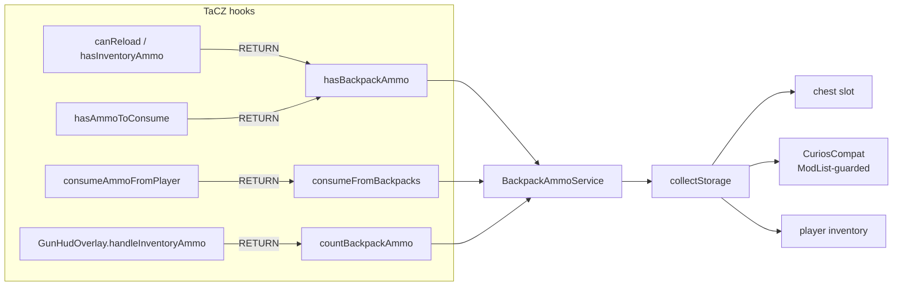

# Architecture

## One-line design

TaCZ asks "does the player have ammo?" only about the player inventory.
Three RETURN-injects OR-in the backpack scan; one drain-inject takes the
remainder after TaCZ empties the inventory. Nothing is redirected —
RETURN injects compose with any number of other compat mods.

## Files (`com.poseidon.tacz_warborn_compat`)

| File | Role |
|---|---|
| `TaczWarbornCompat` | `@Mod` entry — registers the SERVER config |
| `config/WarbornCompatConfig` | `enabled`, `wornBackpack`, `inventoryBackpacks` |
| `service/BackpackAmmoService` | `hasBackpackAmmo`, `countBackpackAmmo`, `consumeFromBackpacks`, `usesVirtualAmmo`, `collectStorage` |
| `service/CuriosCompat` | Every `CuriosApi` reference — class only loads behind `ModList.isLoaded("curios")` |
| `mixin/AbstractGunItemMixin` | `canReload`, `hasInventoryAmmo` → OR-in `hasBackpackAmmo` |
| `mixin/ModernKineticGunScriptAPIMixin` | `hasAmmoToConsume` → OR-in; `consumeAmmoFromPlayer` → drain remainder |
| `mixin/GunHudOverlayMixin` | `handleInventoryAmmo` → add backpack count to HUD reserve |

## Rules

- `remap = false` on all mixins — TaCZ method names are mod-defined, not
  obfuscated; stable across 1.1.5 → 1.1.8
- `usesVirtualAmmo` guards the consume path — dummy/inventory-feed guns
  never touch real backpack contents
- `consumeFromBackpacks` uses TaCZ's own
  `gun.findAndExtractInventoryAmmo(handler, gunStack, remaining)` so ammo
  matching semantics (`isAmmoOfGun`, ammo boxes) stay TaCZ's
- WARBORN's `BackpackItemStackHandler` persists through Forge's normal
  item-capability save — no manual flush needed (unlike TB's wrapper)
